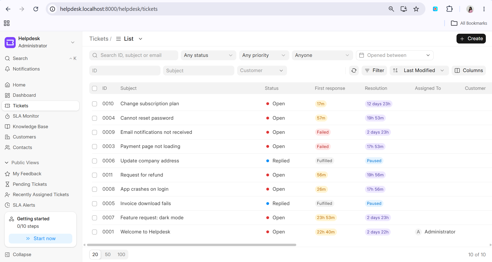
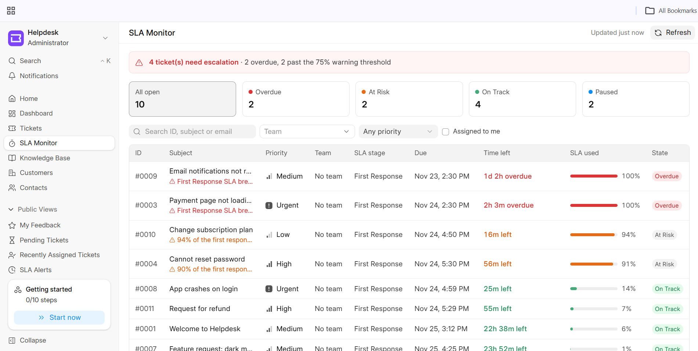
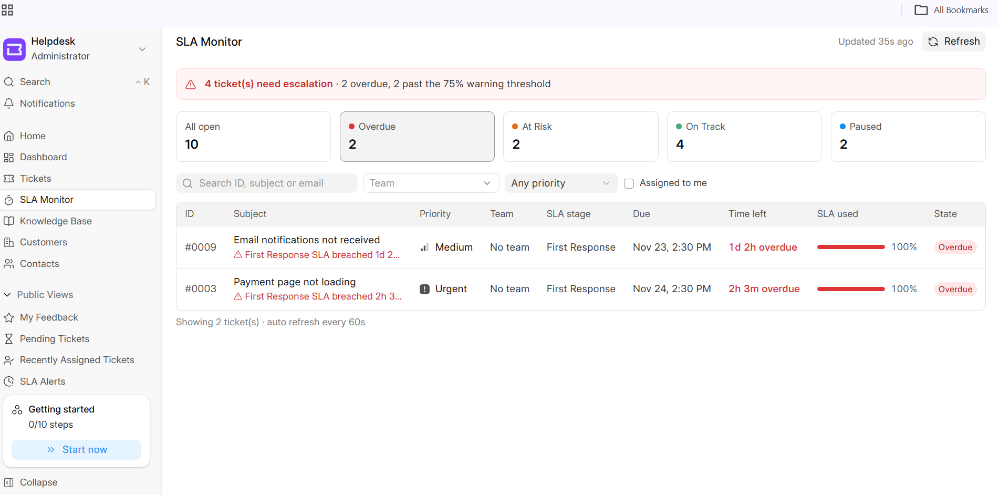

# Frappe Helpdesk: Ticket List Filters & SLA Monitor

**Candidate:** Sujitha S
**Program:** Praskla Technology, 2026 Internship (Final Technical Round)
**Repository:** fork of [frappe/helpdesk](https://github.com/frappe/helpdesk)

| Task | What was built |
|---|---|
| **Modification** | A filter bar on the agent ticket list with search, status, priority, assignee and date filters |
| **New feature** | An **SLA Monitor** page that shows the remaining SLA time, overdue status, escalation warnings and colour indicators |

---

## 1. Project setup

### Prerequisites
- Windows with WSL 2 (Ubuntu) and Docker Desktop, with WSL integration turned on for that Ubuntu distro
- Git, plus a GitHub account with a fork of `frappe/helpdesk`

### Steps (Docker)
```bash
git clone https://github.com/<your-user>/s-frappe-helpdesk.git
cd s-frappe-helpdesk/docker
# Change the MariaDB image to mariadb:11.8 (see Challenges, item 2)
docker compose up -d
docker compose logs -f frappe        # wait for "bench start"
```
Then open `http://helpdesk.localhost:8000/helpdesk` and log in as `Administrator` with the password `admin`.

### Load this repository's code into the bench
The bench inside the container lives at `/home/frappe/frappe-bench`, and the app is at `apps/helpdesk`.
```bash
docker compose exec frappe bash
cd /home/frappe/frappe-bench/apps/helpdesk
git remote add fork https://github.com/<your-user>/s-frappe-helpdesk.git
git fetch fork && git checkout -b feature/sla-monitor fork/feature/sla-monitor
cd ../..
bench --site helpdesk.localhost migrate          # adds the new HD Settings fields
bench build --app helpdesk                        # rebuilds the Vue frontend
bench --site helpdesk.localhost clear-cache
```

### Run the tests
```bash
bench --site helpdesk.localhost set-config allow_tests true
bench --site helpdesk.localhost run-tests --app helpdesk --module helpdesk.tests.api.test_sla_monitor
```

---

## 2. Architecture overview

| Layer | Location | Notes |
|---|---|---|
| Backend (Python, Frappe) | `helpdesk/` | DocTypes in `helpdesk/helpdesk/doctype/`, whitelisted APIs in `helpdesk/api/` |
| Agent UI (Vue 3, TypeScript, frappe-ui) | `desk/src/` | Pages in `pages/`, shared components in `components/`, Pinia stores in `stores/`, routes in `router/index.ts` |
| List view controls | `desk/src/components/view-controls` | Generic list controls in `desk/src/components/view-controls/` (filters, sort, columns) |
| Database | MariaDB | Each DocType is stored as a `tab<DocType>` table |

How the ticket list works today:
`pages/ticket/Tickets.vue` → `components/ListViewBuilder.vue` → `helpdesk.api.doc.get_list_data` → `frappe.get_list("HD Ticket", filters=...)`.
Before the query runs, the backend resolves the custom filters `@me` and `__assigned_on`.

---

## 3. Database structure (the parts this work touches)

### `tabHD Ticket`: the core table
| Field | Type | Meaning |
|---|---|---|
| `name` | int (autoincrement) | Ticket ID |
| `subject`, `raised_by` | Data | Title and customer email (both searchable) |
| `status` | Link → **HD Ticket Status** | e.g. Open, Replied, Paused, Resolved, Closed |
| `status_category` | Data | `Open`, `Paused` or `Resolved`, copied from the status |
| `priority` | Link → **HD Ticket Priority** | Low, Medium, High, Urgent |
| `agent_group` | Link → **HD Team** | The team that owns the ticket |
| `_assign` | JSON text | Assigned users, e.g. `["agent@x.com"]` (mirrors open **ToDo** rows) |
| `opening_date` | Date | Date the ticket was opened |
| `sla` | Link → **HD Service Level Agreement** | The SLA applied to the ticket |
| `service_level_agreement_creation` | Datetime | When the SLA clock started |
| `response_by` / `resolution_by` | Datetime | SLA due times |
| `first_responded_on` / `resolution_date` | Datetime | When the targets were met |
| `on_hold_since`, `total_hold_time` | Datetime / Duration | Pause tracking |
| `agreement_status` | Select | First Response Due / Resolution Due / Failed / Fulfilled / Paused |
| `contact`, `customer` | Link → Contact / **HD Customer** | Who raised the ticket |

### Relationships
```
HD Ticket ──< ToDo (reference_type = HD Ticket)  → assignment (_assign mirrors open ToDos)
HD Ticket >── HD Ticket Status    (status)
HD Ticket >── HD Ticket Priority  (priority)
HD Ticket >── HD Team             (agent_group) ──< HD Team Item → HD Agent → User
HD Ticket >── HD Service Level Agreement (sla)
                 ├──< HD Service Level Priority   (response/resolution time per priority)
                 ├──< HD Service Day               (working hours)
                 └──< HD Pause Service Level Agreement On Status
HD Ticket >── HD Customer, Contact
HD Settings  (Single DocType: one row per field in tabSingles)
```
`HD Service Level Agreement.apply()` runs when a ticket is saved. It fills in `response_by` and `resolution_by` from the priority's response and resolution times, counting working hours and holidays, and keeps `agreement_status` and the hold time up to date.

### Schema change made in this work
New fields on **HD Settings** (a Single DocType, so the values are stored in `tabSingles`):
| Field | Type | Default | Purpose |
|---|---|---|---|
| `sla_warning_threshold` | Percent | 75 | The share of the SLA window used before a ticket is flagged **At Risk** (escalation warning) |
| `sla_monitor_refresh_interval` | Int (seconds) | 60 | How often the SLA Monitor auto-refreshes (0 turns it off) |

You can change them under **/app/hd-settings → Ticket tab → SLA Monitor**, with no code change.

---

## 4. Modification: improved ticket list filters and search

**UI:** `desk/src/components/ticket-agent/TicketListFilters.vue`, mounted in `pages/ticket/Tickets.vue`

| Control | Filter condition produced |
|---|---|
| Search box (debounced 400 ms) | `["__search", "like", term]` |
| Status | `["status", "=", value]` |
| Priority | `["priority", "=", value]` |
| Assignee: agent / Me | `["_assign", "like", "%user%"]` / `"%@me%"` |
| Assignee: Unassigned | `["_assign", "not like", '%"%']` (any assignment adds a quoted name) |
| Opened between | `["opening_date", "between", [from, to]]` |
| Clear (n) | Removes only the conditions managed by this bar |

Design decisions:
- The bar **reads and writes the same filter list** as the existing Filter button (`ListViewBuilder.applyFilters`, which is now exposed). The two controls stay in sync, filters on other fields are kept, and the result can be saved as a view.
- **Search across several fields.** A list of AND-ed filters can't say "subject OR email OR ID". So `__search` is a pseudo filter that `helpdesk.api.doc.handle_search_filter` resolves on the server: it matches `name`, the title field and the DocType's `search_fields` (for tickets that is subject, status and raised_by) with LIKE, then turns the matches into a `name in (...)` filter. This follows the existing `__assigned_on` pattern and works with permissions through `frappe.get_list`.
- `__search` is also resolved in the export and the ticket-to-ticket navigation, so no code path sends an unknown column to SQL. The ticket export now goes through a new `helpdesk.api.doc.export_list` wrapper that resolves the custom filters before calling Frappe's `export_query`.

---

## 5. New feature: SLA Monitor

**Route:** `/helpdesk/sla-monitor` (sidebar entry "SLA Monitor")
**Backend:** `helpdesk/api/sla_monitor.py` → `get_sla_monitor(team, priority, state, assigned_to_me, search)`, available to agents only
**UI:** `desk/src/pages/sla-monitor/SlaMonitor.vue`

### Logic (per open ticket with an SLA)
1. **Current target:** `response_by` if no first response yet; otherwise `resolution_by` if the ticket isn't resolved yet; otherwise the ticket is skipped.
2. **Window:** from `service_level_agreement_creation` to the target. If the ticket is paused, the clock is frozen at `on_hold_since`.
3. `remaining = target − now` and `used % = elapsed / window × 100`.
4. **State:**
   | State | Rule | Colour |
   |---|---|---|
   | Overdue | remaining < 0 (stays Overdue even if paused later) | 🔴 red |
   | Paused | ticket in a Paused status | 🔵 blue |
   | At Risk | used % ≥ `sla_warning_threshold` → escalation warning | 🟠 orange |
   | On Track | anything else | 🟢 green |
5. Tickets are sorted by urgency first, then by the least time left.

### UI
- An **escalation banner** shows how many tickets need escalation (overdue plus at risk).
- **Summary tiles** show a count per state and double as filters.
- Filters for search, team, priority and "Assigned to me".
- A table with ID, subject and warning text, priority, team, SLA stage, due time, **live countdown** (ticks every second), an **SLA used** progress bar and a state badge. Clicking a row opens the ticket.
- Auto-refreshes at the interval set in HD Settings. A ticket that passes its target between refreshes turns Overdue on the client right away.

### How it differs from the existing Home "SLA Alerts" widget
The Home widget lists a few tickets with a short reason. The SLA Monitor covers every open SLA ticket and adds the remaining time, the share of the window used, a configurable escalation threshold, pause awareness, filters and auto refresh.

---

## 6. Files changed

| File | Change |
|---|---|
| `helpdesk/api/sla_monitor.py` | **new**: SLA Monitor API and logic |
| `helpdesk/api/doc.py` | `handle_search_filter`, `get_search_fields`, `_pop_custom_filter`, `_merge_search_names`, `export_list`; wired into the list data and export |
| `helpdesk/helpdesk/doctype/hd_ticket/api.py` | Resolve `__search` in ticket navigation filters |
| `helpdesk/helpdesk/doctype/hd_settings/hd_settings.json` | New "SLA Monitor" settings section |
| `helpdesk/tests/api/test_sla_monitor.py` | **new**: 15 tests (state rules, pause, threshold settings, search) |
| `desk/src/components/ticket-agent/TicketListFilters.vue` | **new**: filter bar |
| `desk/src/pages/sla-monitor/SlaMonitor.vue` | **new**: monitor page |
| `desk/src/pages/ticket/Tickets.vue` | Mount the filter bar; export through `export_list` |
| `desk/src/components/ListViewBuilder.vue` | Expose `applyFilters` |
| `desk/src/router/index.ts`, `components/layouts/layoutSettings.ts` | Route and sidebar link |

---

## 7. Challenges and how they were solved

1. **Docker could not be reached from WSL** (permission denied on the Docker socket). Fixed by turning on WSL integration for the Ubuntu distro in Docker Desktop and adding the user to the `docker` group.
2. **MariaDB SSL error during `bench new-site`.** The `mariadb:10.8` image in `docker/docker-compose.yml` failed the client SSL handshake. Fixed by switching to `mariadb:11.8` and recreating the volumes for a clean restart.
3. **Searching several fields with an AND-only filter list.** Solved with the server-side `__search` pseudo filter (section 4).
4. **New fields on a Single DocType have no stored value after migrate,** and `get_single_value` reads them as `0`. That would have switched the warning and refresh off. Fixed by reading `tabSingles` directly and falling back to the DocType default.
5. **Time zones.** SLA targets are stored in the system time zone. The remaining time is computed on the server, so the browser's clock and time zone can't skew it. The client only counts down from the server's value.
6. **Paused SLAs.** The clock is frozen at `on_hold_since`, and a ticket that breached before being paused stays Overdue.

---

## 8. Screenshots
_Add these to `docs/screenshots/`:_
1. The ticket list with the filter bar in use (search plus status/priority filters)
2. The SLA Monitor overview (banner, tiles, colour-coded table)
3. An At Risk ticket with its escalation warning
4. HD Settings → SLA Monitor section

### Captured screenshots

**Ticket list with the new filter bar**



**SLA Monitor: escalation banner, state tiles and colour indicators**



**Overdue and At Risk tickets with escalation warnings**


