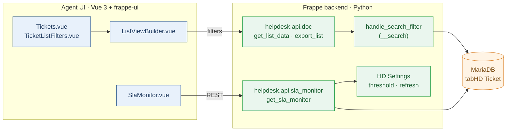
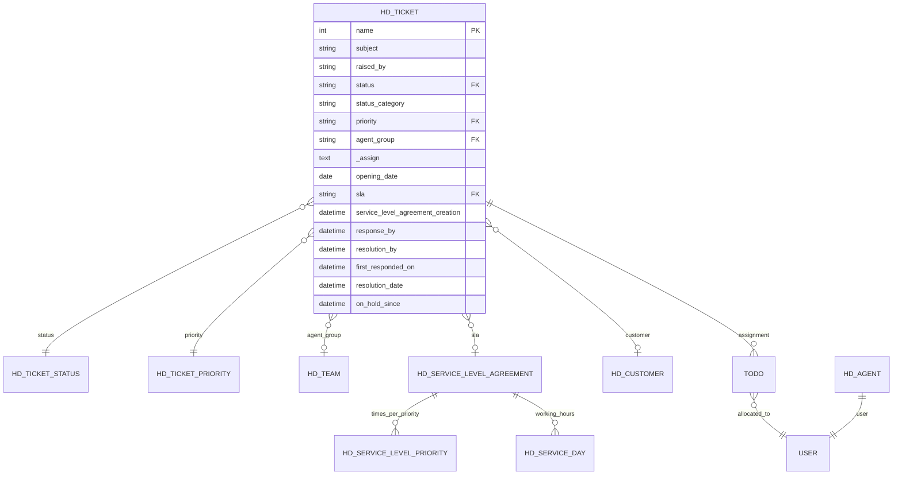
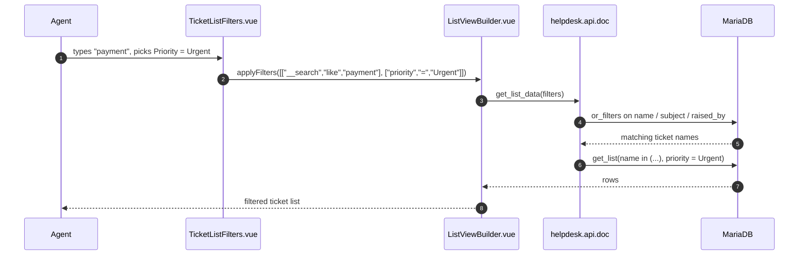
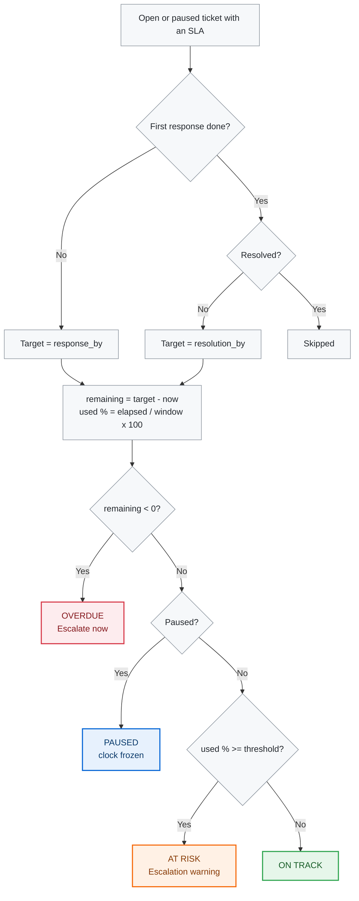
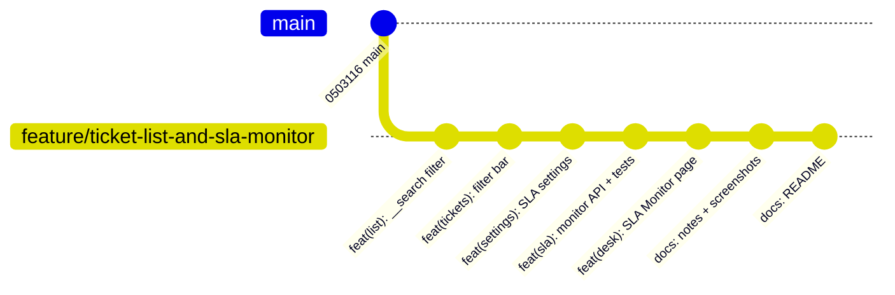
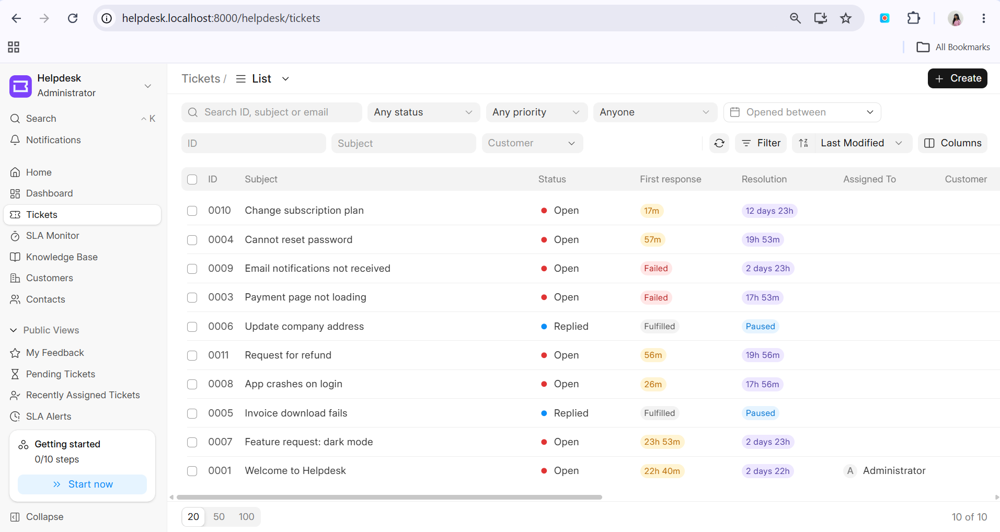
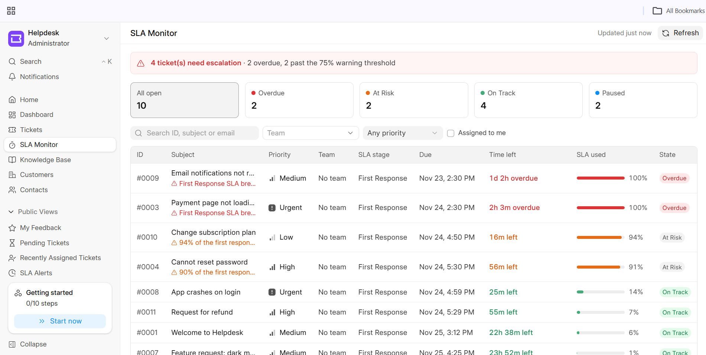
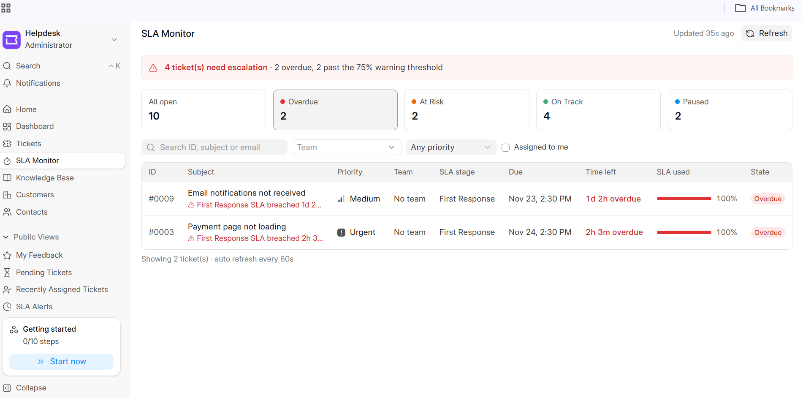

# Frappe Helpdesk: Ticket List Filters & SLA Monitor


**Repository:** fork of [frappe/helpdesk](https://github.com/frappe/helpdesk) · **Base:** `main` (commit `0503116`)

| Task | What was built |
|---|---|
| **Modification** | A filter bar on the agent ticket list: **Search**, **Status**, **Priority**, **Assignee** and **Date** filters |
| **New feature** | An **SLA Monitor** page showing **remaining SLA time**, **overdue status**, **escalation warnings** and **colour indicators** |

---

## Contents
1. [Project setup](#1-project-setup)
2. [Architecture overview](#2-architecture-overview)
3. [Database structure](#3-database-structure)
4. [Modification: ticket list filters and search](#4-modification-ticket-list-filters-and-search)
5. [New feature: SLA Monitor](#5-new-feature-sla-monitor)
6. [Testing](#6-testing)
7. [Files changed and commits](#7-files-changed-and-commits)
8. [Challenges and solutions](#8-challenges-and-solutions)
9. [Screenshots](#9-screenshots)

---

## 1. Project setup

### Prerequisites
| Tool | Version / note |
|---|---|
| Windows + WSL 2 | Ubuntu distro |
| Docker Desktop | WSL integration turned on for Ubuntu |
| Git | Fork: `suji2826/s-frappe-helpdesk` |

### Steps
```bash
# 1. Clone the fork inside WSL Ubuntu
git clone https://github.com/suji2826/s-frappe-helpdesk.git
cd s-frappe-helpdesk/docker

# 2. In docker-compose.yml set the MariaDB image to mariadb:11.8 (see Challenges, item 2)

# 3. Start MariaDB + Redis + the Frappe bench
docker compose up -d
docker compose logs -f frappe        # wait until "bench start" is running
```
Open **http://helpdesk.localhost:8000/helpdesk** and log in as `Administrator` with the password `admin`.

### Load this branch into the bench
```bash
docker exec -it <frappe-container> bash
cd /home/frappe/frappe-bench/apps/helpdesk
git remote add fork https://github.com/suji2826/s-frappe-helpdesk.git
git fetch fork feature/ticket-list-and-sla-monitor
git checkout -b feature/ticket-list-and-sla-monitor FETCH_HEAD

cd /home/frappe/frappe-bench
bench --site helpdesk.localhost migrate         # adds the new HD Settings fields
bench build --app helpdesk                      # rebuilds the Vue agent UI
bench --site helpdesk.localhost clear-cache
```

---

## 2. Architecture overview



| Layer | Location | Notes |
|---|---|---|
| Backend (Python, Frappe) | `helpdesk/` | DocTypes in `helpdesk/helpdesk/doctype/`, whitelisted APIs in `helpdesk/api/` |
| Agent UI (Vue 3, TypeScript, frappe-ui) | `desk/src/` | Pages in `pages/`, components in `components/`, Pinia stores in `stores/`, routes in `router/index.ts` |
| List view controls | `desk/src/components/view-controls/` | Filter, sort, columns, quick filters |
| Database | MariaDB | Each DocType is stored as a `tab<DocType>` table |

**How the ticket list loads:** `Tickets.vue` → `ListViewBuilder.vue` → `helpdesk.api.doc.get_list_data` → `frappe.get_list("HD Ticket", filters=…)`. Before the query runs, the backend resolves the custom filters `@me`, `__assigned_on` and the new `__search`.

---

## 3. Database structure



### `tabHD Ticket`: the fields this work uses
| Field | Type | Meaning |
|---|---|---|
| `name` | int (autoincrement) | Ticket ID |
| `subject`, `raised_by` | Data | Title and customer email (both searchable) |
| `status` | Link → HD Ticket Status | e.g. Open, Replied, Resolved, Closed |
| `status_category` | Data | `Open`, `Paused` or `Resolved` |
| `priority` | Link → HD Ticket Priority | Low, Medium, High, Urgent |
| `agent_group` | Link → HD Team | The team that owns the ticket |
| `_assign` | JSON text | Assigned users, mirrors the open **ToDo** rows |
| `opening_date` | Date | Date the ticket was opened |
| `sla` | Link → HD Service Level Agreement | The SLA applied to the ticket |
| `service_level_agreement_creation` | Datetime | When the SLA clock started |
| `response_by` / `resolution_by` | Datetime | SLA due times |
| `first_responded_on` / `resolution_date` | Datetime | When the targets were met |
| `on_hold_since` | Datetime | When the ticket was paused |

`HD Service Level Agreement.apply()` runs when a ticket is saved. It fills in `response_by` and `resolution_by` from the response and resolution times for the ticket's priority, counting working hours and holidays.

### Schema change made in this work
Two new fields on **HD Settings** (a Single DocType, so the values are stored in `tabSingles`):

| Field | Type | Default | Purpose |
|---|---|---|---|
| `sla_warning_threshold` | Percent | 75 | The share of the SLA window used before a ticket is flagged **At Risk** |
| `sla_monitor_refresh_interval` | Int (seconds) | 60 | Auto-refresh interval of the SLA Monitor (0 turns it off) |

You can change them under **/app/hd-settings → Ticket tab → SLA Monitor**, with no code change.

---

## 4. Modification: ticket list filters and search

**UI:** `desk/src/components/ticket-agent/TicketListFilters.vue`, mounted in `desk/src/pages/ticket/Tickets.vue`

| Control | Filter condition produced |
|---|---|
| Search (debounced 400 ms) | `["__search", "like", term]`, which matches ID, subject, status and email |
| Status | `["status", "=", value]` |
| Priority | `["priority", "=", value]` |
| Assignee: an agent / Assigned to me | `["_assign", "like", "%user%"]` / `"%@me%"` |
| Assignee: Unassigned | `["_assign", "not like", '%"%']` |
| Opened between | `["opening_date", "between", [from, to]]` |
| Clear (n) | Removes only the conditions this bar manages |



**Design decisions**
- The bar reads and writes the **same filter list** as the existing Filter button (`ListViewBuilder.applyFilters` is now exposed). The two controls stay in sync, filters on other fields are kept, and the result can be saved as a view.
- **Searching several fields at once:** Frappe filters are AND-ed, so "subject OR email OR ID" can't be written as a normal filter. `__search` is a pseudo filter that `handle_search_filter()` resolves on the server into `name in (...)`. This follows the existing `__assigned_on` pattern and respects permissions through `frappe.get_list`.
- `__search` is also resolved in **export** (the new `export_list` wrapper) and in **ticket navigation**, so no path sends an unknown column to SQL.
- The existing quick filters, Filter button, sorting, columns and views still work as before.

---

## 5. New feature: SLA Monitor

**Route:** `/helpdesk/sla-monitor` (sidebar → SLA Monitor)
**Backend:** `helpdesk/api/sla_monitor.py` → `get_sla_monitor(team, priority, state, assigned_to_me, search)`, agents only
**UI:** `desk/src/pages/sla-monitor/SlaMonitor.vue`

### State indicators


| State | Rule | Colour |
|---|---|---|
| **Overdue** | remaining < 0 (stays Overdue even if the ticket is paused later) | Red |
| **At Risk** | % of the SLA window used ≥ `sla_warning_threshold` → **escalation warning** | Orange |
| **On Track** | inside the window and below the threshold | Green |
| **Paused** | the ticket's status is in the Paused category | Blue |

### How the state is calculated


### What the page shows
- **Escalation banner:** "N ticket(s) need escalation · X overdue, Y past the 75% warning threshold"
- **Summary tiles:** All open / Overdue / At Risk / On Track / Paused, with counts. Clicking a tile filters the table.
- **Filters:** search, team, priority, "Assigned to me"
- **Table:** ID, subject with the warning text, priority, team, SLA stage, due time, **live countdown** (updates every second), **SLA used** progress bar and a state badge. Clicking a row opens the ticket.
- **Auto refresh** at the interval set in HD Settings. A ticket whose deadline passes between refreshes turns Overdue on screen right away.
- Sorted by urgency: Overdue → At Risk → On Track → Paused, then by the least time left.

### Why this design
- **Time is computed on the server** in the system time zone, so the browser's clock and time zone can't skew it. The browser only counts down from the server's value.
- **Pause-aware:** a paused clock is frozen at `on_hold_since`, so paused tickets don't show a false breach.
- **Goes further than the existing Home "SLA Alerts" widget:** it covers every open SLA ticket and adds the remaining time, % used, a configurable escalation threshold, filters and auto refresh.

---

## 6. Testing
```bash
bench --site helpdesk.localhost set-config allow_tests true
bench --site helpdesk.localhost run-tests --app helpdesk --module helpdesk.tests.api.test_sla_monitor
```
Result: **`Ran 15 tests … OK`**

| Test group | Covers |
|---|---|
| `TestEvaluateTicket` (8) | On Track / At Risk / Overdue rules, switching from response to resolution, frozen paused clock, a breach before a pause stays Overdue, tickets with nothing pending are skipped, duration format |
| `TestMonitorSettings` (4) | Threshold read from HD Settings, invalid-threshold fallback, summary totals, unknown state rejected |
| `TestSearchFilter` (3) | `__search` matches subject and email, and a blank search is ignored |

---

## 7. Files changed and commits

| File | Change |
|---|---|
| `helpdesk/api/sla_monitor.py` | **new**: SLA Monitor API and logic |
| `helpdesk/tests/api/test_sla_monitor.py` | **new**: 15 tests |
| `desk/src/pages/sla-monitor/SlaMonitor.vue` | **new**: monitor page |
| `desk/src/components/ticket-agent/TicketListFilters.vue` | **new**: filter bar |
| `helpdesk/api/doc.py` | `__search` pseudo filter + `export_list` wrapper |
| `helpdesk/helpdesk/doctype/hd_ticket/api.py` | `__search` in ticket navigation |
| `helpdesk/helpdesk/doctype/hd_settings/hd_settings.json` | New SLA Monitor settings section |
| `desk/src/pages/ticket/Tickets.vue` | Mounts the filter bar; export through `export_list` |
| `desk/src/components/ListViewBuilder.vue` | Exposes `applyFilters` |
| `desk/src/router/index.ts`, `desk/src/components/layouts/layoutSettings.ts` | Route and sidebar link |



---

## 8. Challenges and solutions

| # | Challenge | Solution |
|---|---|---|
| 1 | Docker was unreachable from WSL (permission denied on the Docker socket) | Turned on WSL integration for Ubuntu in Docker Desktop and fixed the Docker permissions |
| 2 | MariaDB SSL error during `bench new-site` with `mariadb:10.8` | Switched the image to `mariadb:11.8` and did a clean restart with fresh volumes |
| 3 | Searching several fields with an AND-only filter list | Server-side `__search` pseudo filter, following the existing `__assigned_on` pattern |
| 4 | The first patches targeted `develop`, but the bench runs `main` (commit `0503116`), so `git am` failed | Rebased onto the exact base commit, adapted the imports, and added an `export_list` wrapper because `main` has no grouped export |
| 5 | New fields on a Single DocType have no stored value after migrate (read as `0`) | Read `tabSingles` directly and fall back to the DocType default |
| 6 | Time zones and paused SLAs | Remaining time computed on the server; paused clock frozen at `on_hold_since` |
| 7 | Pushing from a shallow ("grafted") clone; GitHub rejected workflow files | `git fetch --unshallow`, and a Personal Access Token with the `workflow` scope |
| 8 | Demo data for every SLA state | Created tickets and moved SLA timestamps through `bench console` |

---

## 9. Screenshots

### Ticket list with the new filter bar


### SLA Monitor: escalation banner, state tiles and colour indicators


### Overdue and At Risk tickets with escalation warnings


---

<sub>Original Frappe Helpdesk README: [docs/FRAPPE_HELPDESK_README.md](docs/FRAPPE_HELPDESK_README.md) · Built on [Frappe Helpdesk](https://github.com/frappe/helpdesk) (AGPL-3.0)</sub>
