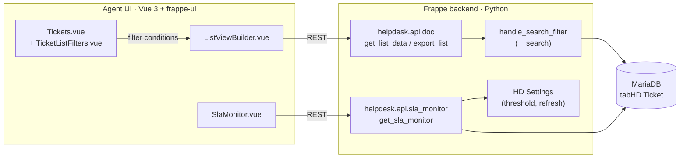
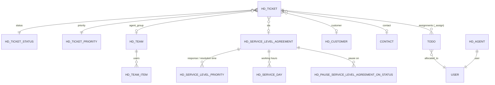
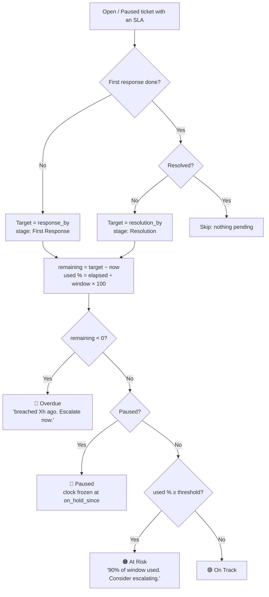

<div align="center">


# Frappe Helpdesk: Smart Ticket Filters & SLA Monitor

**Praskla Technology · 2026 Internship Program · Final Technical Round**

**Candidate:** Sujitha S &nbsp;|&nbsp; **Branch:** `feature/ticket-list-and-sla-monitor` &nbsp;|&nbsp; **Upstream:** [frappe/helpdesk](https://github.com/frappe/helpdesk)


</div>

---

## 📌 Table of contents
1. [Assignment at a glance](#-assignment-at-a-glance)
2. [Demo screenshots](#-demo-screenshots)
3. [Project setup](#-project-setup)
4. [Architecture and codebase understanding](#-architecture-and-codebase-understanding)
5. [Database structure and relationships](#-database-structure-and-relationships)
6. [Modification: improved ticket list](#-modification-improved-ticket-list-filters-and-search)
7. [New feature: SLA Monitor](#-new-feature-sla-monitor)
8. [Configuration (no hardcoded values)](#-configuration-no-hardcoded-values)
9. [Testing](#-testing)
10. [Files changed and Git history](#-files-changed-and-git-history)
11. [Challenges faced and how I solved them](#-challenges-faced-and-how-i-solved-them)
12. [Rules compliance checklist](#-rules-compliance-checklist)

---

## 🎯 Assignment at a glance

| | Requirement | Delivered |
|---|---|---|
| 🛠️ **Modification** | Improve the ticket list with **priority, status, assignee and date filters**, plus **search** | A new filter bar above the agent ticket list: **Search** (ID / subject / email), **Status**, **Priority**, **Assignee** (Me / Unassigned / any agent), **Opened between** (date range) and **Clear** |
| ✨ **New feature** | **SLA Monitor** showing **remaining SLA**, **overdue status**, **escalation warning** and **colour indicators** | A new **SLA Monitor** page in the sidebar with a live countdown, % of the SLA window used, an escalation banner, per-ticket warnings and 🔴 / 🟠 / 🟢 / 🔵 state indicators |

---

## 📸 Demo screenshots

### 1. Ticket list with the new filter bar


### 2. SLA Monitor: escalation banner, state tiles and colour indicators


### 3. Overdue and At Risk tickets with escalation warnings


---

## ⚙️ Project setup

### Prerequisites
| Tool | Used |
|---|---|
| OS | Windows 11 + **WSL 2 (Ubuntu)** |
| Containers | **Docker Desktop**, with WSL integration turned on for Ubuntu |
| Source | Fork: `suji2826/s-frappe-helpdesk` |

### Step-by-step

```bash
# 1. Clone the fork (inside WSL Ubuntu)
git clone https://github.com/suji2826/s-frappe-helpdesk.git
cd s-frappe-helpdesk/docker

# 2. In docker-compose.yml, change the MariaDB image (see Challenge 2):
#      image: mariadb:10.8   →   image: mariadb:11.8

# 3. Start the stack (MariaDB + Redis + Frappe bench)
docker compose up -d
docker compose logs -f frappe          # wait until "bench start" is running
```

Open **http://helpdesk.localhost:8000/helpdesk** and log in as `Administrator` with the password `admin`.

### Load this branch into the running bench

```bash
docker exec -it <frappe-container> bash          # e.g. frappe-helpdesk-frappe-1
cd /home/frappe/frappe-bench/apps/helpdesk
git remote add fork https://github.com/suji2826/s-frappe-helpdesk.git
git fetch fork feature/ticket-list-and-sla-monitor
git checkout -b feature/ticket-list-and-sla-monitor FETCH_HEAD

cd /home/frappe/frappe-bench
bench --site helpdesk.localhost migrate          # adds the new HD Settings fields
bench build --app helpdesk                       # rebuilds the Vue agent UI
bench --site helpdesk.localhost clear-cache
exit
docker restart <frappe-container>
```

### Optional: demo data for every SLA state
In `bench --site helpdesk.localhost console`:
```python
from frappe.utils import add_to_date
t = frappe.get_all("HD Ticket", filters={"status_category": "Open"}, pluck="name", order_by="creation asc")
# Overdue: target was 2 hours ago
frappe.db.set_value("HD Ticket", t[1], {"service_level_agreement_creation": add_to_date(None, hours=-5), "response_by": add_to_date(None, hours=-2)})
# At Risk: 90% of the window used
frappe.db.set_value("HD Ticket", t[2], {"service_level_agreement_creation": add_to_date(None, hours=-9), "response_by": add_to_date(None, hours=1)})
frappe.db.commit()
```

---

## 🏗️ Architecture and codebase understanding

Frappe Helpdesk is a **Frappe Framework app**: a Python backend with metadata-driven DocTypes and a **Vue 3 single-page app** for agents.



| Layer | Location | Role |
|---|---|---|
| DocTypes (schema + controllers) | `helpdesk/helpdesk/doctype/` | `HD Ticket`, `HD Service Level Agreement`, `HD Settings`, … |
| Whitelisted APIs | `helpdesk/api/` | Endpoints the UI calls (`@frappe.whitelist()`) |
| Agent UI pages | `desk/src/pages/` | `ticket/Tickets.vue`, `sla-monitor/SlaMonitor.vue` |
| Shared components | `desk/src/components/` | `ListViewBuilder.vue`, `view-controls/`, `ticket-agent/` |
| State | `desk/src/stores/` | Pinia stores for statuses, priorities and agents |
| Routing / sidebar | `desk/src/router/index.ts`, `components/layouts/layoutSettings.ts` | Page routes and the sidebar menu |

**How the ticket list loads:** `Tickets.vue` → `ListViewBuilder.vue` → `helpdesk.api.doc.get_list_data`. The backend resolves custom filters such as `@me` and `__assigned_on`, then calls `frappe.get_list("HD Ticket", …)`, which applies the user's permissions.

**How SLA deadlines are set:** when a ticket is saved, `HD Service Level Agreement.apply()` reads the response and resolution times for the ticket's priority. It counts working hours and holidays, writes `response_by` / `resolution_by`, and keeps `agreement_status` and the hold time up to date.

---

## 🗄️ Database structure and relationships

Every DocType is stored as a MariaDB table named `tab<DocType>` (e.g. `tabHD Ticket`). A **Single** DocType such as `HD Settings` stores one row per field in `tabSingles`.



### `tabHD Ticket`: the fields this work uses

| Field | Type | Used for |
|---|---|---|
| `name` | Int (autoincrement) | Ticket ID · search |
| `subject`, `raised_by` | Data | Search (subject, customer email) |
| `status` → **HD Ticket Status** | Link | Status filter |
| `status_category` | Data (`Open` / `Paused` / `Resolved`) | Which tickets have a running SLA clock |
| `priority` → **HD Ticket Priority** | Link | Priority filter |
| `_assign` | JSON text (`["agent@x.com"]`) | Assignee filter. Mirrors the open **ToDo** rows |
| `opening_date` | Date | Date-range filter |
| `agent_group` → **HD Team** | Link | SLA Monitor team filter |
| `sla` → **HD Service Level Agreement** | Link | Only tickets with an SLA are monitored |
| `service_level_agreement_creation` | Datetime | Start of the SLA window |
| `response_by` / `resolution_by` | Datetime | SLA targets (due times) |
| `first_responded_on` / `resolution_date` | Datetime | Whether a target is already met |
| `on_hold_since`, `total_hold_time` | Datetime / Duration | Pause handling |
| `agreement_status` | Select | Frappe's own SLA status (First Response Due, Failed, …) |

### Schema change in this work
Two new fields on **HD Settings**, in a new *SLA Monitor* section under the Ticket tab:

| Field | Type | Default | Meaning |
|---|---|---|---|
| `sla_warning_threshold` | Percent | **75** | The share of the SLA window used before a ticket is marked **At Risk** and gets an escalation warning |
| `sla_monitor_refresh_interval` | Int (seconds) | **60** | How often the SLA Monitor refreshes itself (0 turns it off) |

---

## 🛠️ Modification: improved ticket list (filters and search)

**Files:** `desk/src/components/ticket-agent/TicketListFilters.vue` (new), `desk/src/pages/ticket/Tickets.vue`, `desk/src/components/ListViewBuilder.vue`, `helpdesk/api/doc.py`

| Control | Filter condition sent to the server |
|---|---|
| 🔍 **Search** (debounced 400 ms) | `["__search", "like", "<term>"]` → matches **ID, subject, status, raised-by** |
| **Status** | `["status", "=", "<status>"]` (options from HD Ticket Status) |
| **Priority** | `["priority", "=", "<priority>"]` (options from HD Ticket Priority) |
| **Assignee**: an agent / *Assigned to me* | `["_assign", "like", "%<user>%"]` / `"%@me%"` |
| **Assignee**: *Unassigned* | `["_assign", "not like", '%"%']` (any assignment adds a quoted name) |
| **Opened between** | `["opening_date", "between", [from, to]]` |
| **Clear (n)** | Removes only the conditions this bar manages |

### Key design decisions
- **One source of truth.** The bar reads and writes the *same* filter list as the existing Filter button (`ListViewBuilder.applyFilters` is now exposed). The two controls stay in sync, filters on other fields are kept, and the result can be **saved as a view**.
- **Search across several fields on the server.** Frappe filters are AND-ed, so "subject OR email OR ID" can't be written as a normal filter. `__search` is a *pseudo filter*: `handle_search_filter()` runs a permission-aware `frappe.get_list(..., or_filters=…)` and turns the matches into `name in (…)`. This follows the existing `__assigned_on` pattern in the codebase.
- **Every path is covered.** `__search` is also resolved in **export** (through the new `export_list` wrapper) and in **next / previous ticket navigation**, so no path sends an unknown column to SQL.
- **Nothing removed.** The existing quick filters (ID / Subject / Customer), the Filter button, sorting, columns and views all work as before.

---

## ✨ New feature: SLA Monitor

**Route:** `/helpdesk/sla-monitor` (sidebar → **SLA Monitor**)
**Backend:** `helpdesk/api/sla_monitor.py` → `get_sla_monitor(team, priority, state, assigned_to_me, search)`, agents only
**UI:** `desk/src/pages/sla-monitor/SlaMonitor.vue`

### How a ticket's SLA state is calculated



| State | Rule | Colour |
|---|---|---|
| **Overdue** | The target has passed (stays Overdue even if the ticket is paused later) | 🔴 Red |
| **At Risk** | % of the SLA window used ≥ `sla_warning_threshold` → **escalation warning** | 🟠 Orange |
| **On Track** | Inside the window and below the threshold | 🟢 Green |
| **Paused** | The ticket's status is in the *Paused* category | 🔵 Blue |

### What the page shows
- 🚨 **Escalation banner**: "*N ticket(s) need escalation · X overdue, Y past the 75% warning threshold*"
- 🧮 **Summary tiles**: All open / Overdue / At Risk / On Track / Paused, with counts. Clicking a tile filters the table.
- 🔎 **Filters**: search, team, priority, "Assigned to me"
- 📋 **Table**: ID, subject (with the warning text), priority, team, SLA stage, due time, **live countdown** (updates every second), **SLA used** progress bar and a state badge. Clicking a row opens the ticket.
- 🔄 **Auto refresh** at the interval set in HD Settings. A ticket whose deadline passes between refreshes turns **Overdue** on screen right away.
- Tickets are sorted by urgency: Overdue → At Risk → On Track → Paused, then by the least time left.

### Why this design
- **Time is computed on the server**, in the system time zone the SLA targets are stored in, so the browser's clock or time zone can't skew it. The browser only counts down from the server's value.
- **Pause-aware**: a paused clock is frozen at `on_hold_since`, so paused tickets don't show a false breach.
- **It goes further than the existing Home "SLA Alerts" widget**, which shows a few tickets with a short reason. The Monitor covers *every* open SLA ticket and adds the remaining time, % used, a configurable escalation threshold, filters and auto refresh.

### API response (example)
```json
{
  "settings": { "warning_threshold": 75, "refresh_interval": 60 },
  "summary":  { "Overdue": 2, "At Risk": 2, "On Track": 4, "Paused": 1, "total": 9, "needs_escalation": 4 },
  "tickets": [{
    "name": "0003", "subject": "Payment page not loading", "priority": "Urgent",
    "stage": "First Response", "due": "2026-11-24 14:30:00",
    "remaining_seconds": -7200, "used_percent": 100.0, "state": "Overdue",
    "escalation_warning": "First Response SLA breached 2h 0m ago. Escalate now."
  }]
}
```

---

## 🔧 Configuration (no hardcoded values)

Go to **`/app/hd-settings` → Ticket tab → SLA Monitor**:

- **Escalation warning threshold (%)**: e.g. set it to 50 to warn earlier
- **SLA Monitor refresh interval (seconds)**: set it to 0 to turn auto refresh off

Status, priority, team and agent options are all **read from the database**, so custom statuses and priorities appear automatically.

---

## 🧪 Testing

```bash
bench --site helpdesk.localhost set-config allow_tests true
bench --site helpdesk.localhost run-tests --app helpdesk --module helpdesk.tests.api.test_sla_monitor
```
**Result: `Ran 15 tests … OK`**

| Test group | What it checks |
|---|---|
| `TestEvaluateTicket` (8) | On Track / At Risk / Overdue rules, switching from response to resolution, frozen paused clock, a breach before a pause stays Overdue, tickets with nothing pending are skipped, duration formatting |
| `TestMonitorSettings` (4) | The threshold is read from HD Settings, an invalid threshold falls back to the default, the summary adds up, an unknown state is rejected |
| `TestSearchFilter` (3) | `__search` matches subject and raised-by, and a blank search is ignored |

I also tested by hand in the browser: every filter on its own and combined, Clear, saved views, export, and the SLA Monitor with Overdue, At Risk, Paused and On Track demo tickets.

---

## 📂 Files changed and Git history

| File | Change |
|---|---|
| `helpdesk/api/sla_monitor.py` | 🆕 SLA Monitor API and state logic |
| `helpdesk/tests/api/test_sla_monitor.py` | 🆕 15 tests |
| `desk/src/pages/sla-monitor/SlaMonitor.vue` | 🆕 SLA Monitor page |
| `desk/src/components/ticket-agent/TicketListFilters.vue` | 🆕 Ticket filter bar |
| `helpdesk/api/doc.py` | `__search` pseudo filter + `export_list` wrapper |
| `helpdesk/helpdesk/doctype/hd_ticket/api.py` | `__search` in ticket navigation |
| `helpdesk/helpdesk/doctype/hd_settings/hd_settings.json` | New SLA Monitor settings fields |
| `desk/src/pages/ticket/Tickets.vue` | Mounts the filter bar; export through `export_list` |
| `desk/src/components/ListViewBuilder.vue` | Exposes `applyFilters` |
| `desk/src/router/index.ts`, `desk/src/components/layouts/layoutSettings.ts` | Route and sidebar link |

**Commits (Conventional Commits style):**
```
feat(list): add __search pseudo filter for multi-field list search
feat(tickets): add search, status, priority, assignee and date filters to ticket list
feat(settings): add SLA Monitor warning threshold and refresh interval to HD Settings
feat(sla): add SLA Monitor API with remaining time, overdue and escalation states
feat(desk): add SLA Monitor page with live countdown and colour indicators
docs: add implementation notes for ticket filters and SLA Monitor
docs: add screenshots and link implementation notes from README
docs: rewrite README for the internship submission
```

---

## 🧗 Challenges faced and how I solved them

| # | Challenge | Approach / fix |
|---|---|---|
| 1 | **Docker unreachable from WSL** (permission denied on the Docker socket) | Turned on *WSL integration* for Ubuntu in Docker Desktop and fixed the user's Docker permissions |
| 2 | **MariaDB SSL error** during `bench new-site` with the `mariadb:10.8` image | Switched the image to **`mariadb:11.8`** and did a clean restart with fresh volumes |
| 3 | **Searching several fields with an AND-only filter list** | Built the server-side `__search` pseudo filter, following the existing `__assigned_on` pattern |
| 4 | **My code didn't match the version in my container.** My first patches were written against `develop`, but my bench runs the stable `main` branch (commit `0503116`), so `git am` failed | Found the exact base commit, rebased the work onto it, adapted the imports (e.g. `normalizeFilters` path, `dayjsLocal` from frappe-ui) and added an `export_list` wrapper, because `main` has no grouped export |
| 5 | **New fields on a Single DocType** have no stored value after migrate, and `get_single_value` reads them as `0` | Read `tabSingles` directly and fall back to the DocType default |
| 6 | **Time zones and paused SLAs** | Compute remaining time on the server; freeze paused clocks at `on_hold_since`; keep a breach that happened before a pause marked Overdue |
| 7 | **Pushing from a shallow ("grafted") clone** and GitHub rejecting workflow files | Ran `git fetch --unshallow`, and gave the Personal Access Token the `workflow` scope |
| 8 | **Demo data for every SLA state** | Created tickets and moved SLA timestamps through `bench console` to show Overdue, At Risk and Paused cases |

---

## ✅ Rules compliance checklist

- [x] No existing functionality removed or altered. The old filters, views, sorting and export still work.
- [x] No hardcoded values. The threshold and refresh interval live in **HD Settings**, and options come from the database.
- [x] Follows project conventions: Vue 3 `<script setup lang="ts">`, frappe-ui components, Tailwind semantic tokens, `@frappe.whitelist()` + `@agent_only`, the black / flake8 / prettier style
- [x] Permission-aware: everything goes through `frappe.get_list`
- [x] Meaningful, conventional Git commit messages
- [x] Automated tests included (15 passing)
- [x] Screenshots included

---

<div align="center">

**About Frappe Helpdesk:** open-source customer service software by Frappe · [Website](https://frappe.io/helpdesk) · [Docs](https://docs.frappe.io/helpdesk) · [Original README](docs/FRAPPE_HELPDESK_README.md)

Made with ❤️ by **Sujitha S** for the Praskla Technology Internship 2026

</div>
